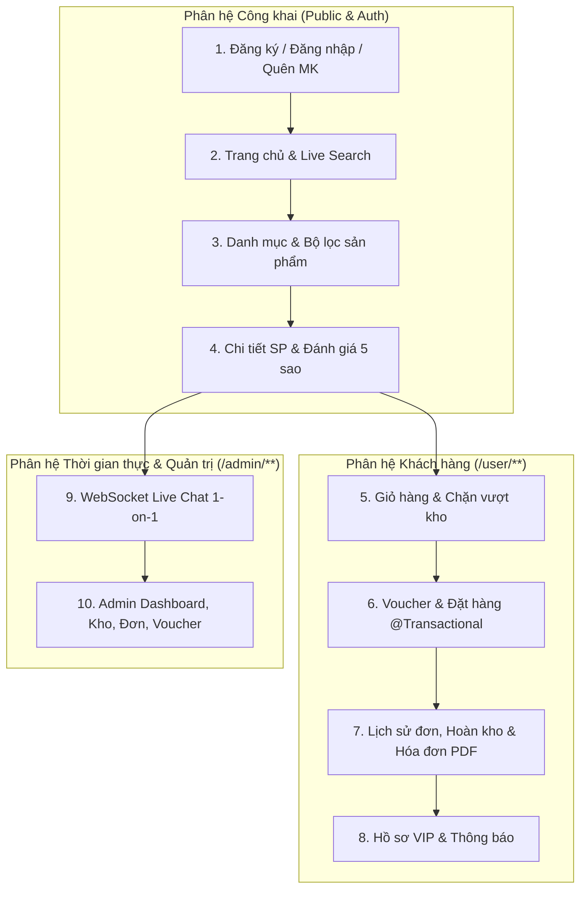

# TÀI LIỆU KIỂM THỬ CHI TIẾT TỪNG CHỨC NĂNG (QA/QC TEST PLAN & TEST CASES)
## Dự Án: Hệ Thống Thương Mại Điện Tử Cao Cấp — E-COMMERCE

> **Phiên bản tài liệu:** 2.0 (Cập nhật sau khi nâng cấp Kiến trúc Giao dịch `@Transactional`, `@Async` Email & Giao diện Google Stitch Luxury Black & Gold Design System)  
> **Công nghệ:** Java 17, Spring Boot, Spring Security 6, Spring Data JPA, WebSocket STOMP, Thymeleaf, Bootstrap 5.3.3, MySQL  

---

## MỤC LỤC
1. [Môi Trường & Dữ Liệu Kiểm Thử Chuẩn](#1-môi-trường--dữ-liệu-kiểm-thử-chuẩn)
2. [Ma Trận Bao Phủ Kiểm Thử (Test Coverage Matrix)](#2-ma-trận-bao-phủ-kiểm-thử-test-coverage-matrix)
3. [Chức Năng 1: Đăng Ký, Đăng Nhập, Khóa Tài Khoản & Quên Mật Khẩu](#3-chức-năng-1-đăng-ký-đăng-nhập-khóa-tài-khoản--quên-mật-khẩu)
4. [Chức Năng 2: Trang Chủ, Flash Sale & Tìm Kiếm Trực Tiếp (Live Search)](#4-chức-năng-2-trang-chủ-flash-sale--tìm-kiếm-trực-tiếp-live-search)
5. [Chức Năng 3: Danh Mục Sản Phẩm, Bộ Lọc Nâng Cao & Phân Trang](#5-chức-năng-3-danh-mục-sản-phẩm-bộ-lọc-nâng-cao--phân-trang)
6. [Chức Năng 4: Chi Tiết Sản Phẩm, Đánh Giá Sao & Kiểm Soát Tồn Kho](#6-chức-năng-4-chi-tiết-sản-phẩm-đánh-giá-sao--kiểm-soát-tồn-kho)
7. [Chức Năng 5: Giỏ Hàng Thông Minh (Cộng Dồn & Chặn Vượt Tồn Kho)](#7-chức-năng-5-giỏ-hàng-thông-minh-cộng-dồn--chặn-vượt-tồn-kho)
8. [Chức Năng 6: Áp Dụng Voucher & Thanh Toán Đặt Hàng Nguyên Tử (`@Transactional`)](#8-chức-năng-6-áp-dụng-voucher--thanh-toán-đặt-hàng-nguyên-tử-transactional)
9. [Chức Năng 7: Quản Lý Đơn Hàng Khách Hàng, Hoàn Kho Tự Động & Hóa Đơn PDF VAT](#9-chức-năng-7-quản-lý-đơn-hàng-khách-hàng-hoàn-kho-tự-động--hóa-đơn-pdf-vat)
10. [Chức Năng 8: Hồ Sơ Cá Nhân VIP, Bảo Mật Mật Khẩu & Trung Tâm Thông Báo](#10-chức-năng-8-hồ-sơ-cá-nhân-vip-bảo-mật-mật-khẩu--trung-tâm-thông-báo)
11. [Chức Năng 9: Hỗ Trợ Trực Tuyến Thời Gian Thực 1-on-1 (WebSocket STOMP Live Chat)](#11-chức-năng-9-hỗ-trợ-trực-tuyến-thời-gian-thực-1-on-1-websocket-stomp-live-chat)
12. [Chức Năng 10: Bảng Điều Khiển Quản Trị Viên (Admin Executive Console & CRUD)](#12-chức-năng-10-bảng-điều-khiển-quản-trị-viên-admin-executive-console--crud)
13. [Chức Năng 11: Kiểm Thử Giao Diện Stitch Design System, CSP & Hiệu Năng](#13-chức-năng-11-kiểm-thử-giao-diện-stitch-design-system-csp--hiệu-năng)
14. [Hướng Dẫn Chạy Kiểm Thử Tự Động & Đối Chiếu SQL](#14-hướng-dẫn-chạy-kiểm-thử-tự-động--đối-chiếu-sql)

---

## 1. Môi Trường & Dữ Liệu Kiểm Thử Chuẩn

| Hạng mục | Thông số cấu hình |
|---|---|
| **Địa chỉ ứng dụng (Base URL)** | `http://localhost:8080` |
| **Cơ sở dữ liệu** | MySQL (`ecommerce_db_new`, bảng mã `UTF-8 / utf8mb4`) |
| **Thư mục lưu trữ ảnh ngoài JAR** | `./uploads/product_img/`, `./uploads/category_img/`, `./uploads/profile_img/` |
| **Tài khoản Admin thử nghiệm** | Email: `admin@gmail.com` / Role: `ROLE_ADMIN` |
| **Tài khoản Khách hàng thử nghiệm** | Email: `user@gmail.com` / Role: `ROLE_USER` |
| **Trình duyệt kiểm thử** | Google Chrome / Microsoft Edge (Bật DevTools `F12` -> Console & Network) |



---

## 2. Ma Trận Bao Phủ Kiểm Thử (Test Coverage Matrix)

| STT | Phân hệ chức năng | Số lượng Test Case | Mã Test Case | Trọng tâm kiểm thử |
|---:|---|---:|---|---|
| 1 | Xác thực & Bảo mật tài khoản | 6 | `AUTH-01` -> `AUTH-06` | Split Layout 2 cột, tiếng Việt có khoảng trắng, khóa tài khoản khi sai mật khẩu 3 lần, khôi phục qua email token |
| 2 | Trang chủ & Live Search | 4 | `HOME-01` -> `HOME-04` | Truy vấn `LIMIT 8`, đồng hồ Flash Sale, gợi ý tìm kiếm 200ms trên cả Desktop và Mobile |
| 3 | Danh mục & Bộ lọc sản phẩm | 4 | `CAT-01` -> `CAT-04` | Lọc kết hợp Danh mục + Khoảng giá + Sắp xếp + Từ khóa + Chuyển đổi Grid/List |
| 4 | Chi tiết sản phẩm & Đánh giá | 4 | `PRD-01` -> `PRD-04` | Huy hiệu `Còn hàng` phát sáng, bộ chọn số lượng `+`/`-`, tính điểm trung bình đánh giá sao |
| 5 | Giỏ hàng & Ràng buộc tồn kho | 5 | `CART-01` -> `CART-05` | Cộng dồn khi trùng sản phẩm, chặn vượt `stock` ở cả UI và Backend, sửa số lượng trực tiếp |
| 6 | Voucher & Thanh toán Đặt hàng | 5 | `ORD-01` -> `ORD-05` | Kiểm tra mã giảm giá AJAX, trừ kho nguyên tử `@Transactional`, rollback khi hết hàng, gửi email `@Async` |
| 7 | Lịch sử đơn, Hoàn kho & PDF | 4 | `HIS-01` -> `HIS-04` | Khách hủy đơn tự động hoàn lại tồn kho, chặn sửa trạng thái trái phép, xuất hóa đơn PDF VAT |
| 8 | Hồ sơ cá nhân & Thông báo | 4 | `PRF-01` -> `PRF-04` | Cập nhật thông tin & ảnh đại diện ngoài JAR, đổi mật khẩu BCrypt, đánh dấu đã đọc thông báo |
| 9 | Hỗ trợ trực tuyến Live Chat | 3 | `CHAT-01` -> `CHAT-03` | Chat thời gian thực qua STOMP WebSocket `/topic/chat/{customerId}`, cô lập phòng chat giữa các khách |
| 10 | Quản trị hệ thống Admin | 6 | `ADM-01` -> `ADM-06` | Dashboard Chart.js, CRUD Danh mục/Sản phẩm/Voucher, xử lý đơn hàng, quản lý User/Admin |
| 11 | Giao diện Stitch & Bảo mật CSP | 3 | `UI-01` -> `UI-03` | Không có lỗi `unsafe-eval` CSP, chống bấm đúp (Double-Submit), chuẩn thương hiệu `E-COMMERCE` |

---

## 3. Chức Năng 1: Đăng Ký, Đăng Nhập, Khóa Tài Khoản & Quên Mật Khẩu

* **Controller & Cấu hình:** [HomeController.java](file:///D:/IdeaProjects/Java_Web/src/main/java/com/ecom/controller/HomeController.java), [SecurityConfig.java](file:///D:/IdeaProjects/Java_Web/src/main/java/com/ecom/config/SecurityConfig.java), [AuthFailureHandlerImpl.java](file:///D:/IdeaProjects/Java_Web/src/main/java/com/ecom/config/AuthFailureHandlerImpl.java)
* **Giao diện:** [login.html](file:///D:/IdeaProjects/Java_Web/src/main/resources/templates/login.html), [register.html](file:///D:/IdeaProjects/Java_Web/src/main/resources/templates/register.html), [forgot_password.html](file:///D:/IdeaProjects/Java_Web/src/main/resources/templates/forgot_password.html), [reset_password.html](file:///D:/IdeaProjects/Java_Web/src/main/resources/templates/reset_password.html)

| Mã TC | Kịch bản kiểm thử | Các bước thực hiện & Dữ liệu đầu vào | Kết quả mong đợi (UI & Giao diện) | Kết quả mong đợi (Backend & Database) |
|---|---|---|---|---|
| **AUTH-01** | Đăng ký tài khoản mới hợp lệ với tên Tỉnh/Thành có khoảng trắng | 1. Truy cập `/register`.<br>2. Nhập Họ tên: `Nguyễn Văn An`, SĐT: `0912345678`, Email: `an.nguyen@test.com`.<br>3. Địa chỉ: `Số 10 Đường Láng`, Tỉnh/TP: `Hà Nội`, Quận/Huyện: `Quận Đống Đa`, Mã bưu chính: `100000`.<br>4. Mật khẩu & Xác nhận: `123456`.<br>5. Chọn 1 ảnh `.png`/`.jpg` và bấm **HOÀN TẤT ĐĂNG KÝ THÀNH VIÊN**. | - Không báo lỗi khoảng trắng ở ô Tỉnh/TP và Quận/Huyện.<br>- Nút bấm chuyển sang trạng thái khóa *"Đang xử lý..."* kèm icon xoay.<br>- Hiển thị Toast thông báo xanh: *"Đăng ký tài khoản thành công"*. | - Bản ghi mới trong bảng `user_dtls` với `role = 'ROLE_USER'`, `is_enable = 1`, `account_non_locked = 1`.<br>- Mật khẩu được băm bằng `BCryptPasswordEncoder`.<br>- File ảnh được lưu vào `./uploads/profile_img/` với tên UUID. |
| **AUTH-02** | Đăng ký trùng Email đã tồn tại | 1. Truy cập `/register`.<br>2. Nhập lại email `an.nguyen@test.com` đã đăng ký ở `AUTH-01` cùng các thông tin hợp lệ.<br>3. Bấm **HOÀN TẤT ĐĂNG KÝ THÀNH VIÊN**. | Hiển thị Toast thông báo đỏ: *"Email này đã được đăng ký"*. | `userService.existsEmail("an.nguyen@test.com")` trả về `true`, không sinh thêm bản ghi trùng trong `user_dtls`. |
| **AUTH-03** | Kiểm tra Validation phía Client trên form Đăng ký (`#userRegister`) | 1. Truy cập `/register`, để trống toàn bộ và bấm Submit.<br>2. Nhập SĐT có chữ: `0912abc`, Mật khẩu: `123` (< 6 ký tự), Xác nhận mật khẩu: `456`. | Hiển thị dòng chữ lỗi màu đỏ tiếng Việt ngay bên dưới từng ô input không hợp lệ; chặn gửi request lên server. | Không có HTTP POST `/saveUser` nào được gửi đi khi form chưa hợp lệ. |
| **AUTH-04** | Đăng nhập phân luồng theo vai trò (`ROLE_USER` và `ROLE_ADMIN`) | 1. Truy cập `/signin`, đăng nhập bằng tài khoản Khách hàng (`an.nguyen@test.com` / `123456`).<br>2. Đăng xuất (`/logout`), đăng nhập bằng tài khoản Admin (`admin@gmail.com`). | - Khách hàng được chuyển hướng về trang chủ `/`, Navbar hiện tên người dùng và icon Giỏ hàng/Chuông thông báo.<br>- Admin được chuyển hướng thẳng vào `/admin/` (Bảng điều khiển Quản trị). | `AuthSucessHandlerImpl` kiểm tra `AuthorityUtils.authorityListToSet` và điều hướng chuẩn xác. |
| **AUTH-05** | Tự động khóa tài khoản khi nhập sai mật khẩu 3 lần liên tiếp | 1. Truy cập `/signin`, nhập email `an.nguyen@test.com` và mật khẩu sai `999999` liên tiếp **3 lần**. | - Lần 1 & 2: Báo *"Email hoặc mật khẩu không chính xác"*.<br>- Từ lần 3: Báo *"Tài khoản của bạn đã bị khóa do nhập sai mật khẩu quá 3 lần"*. | Cột `failed_attempt` tăng từ `1 -> 3`, cột `account_non_locked` chuyển thành `0` (`false`) và `lock_time` lưu thời điểm khóa. Tự động mở khóa khi hết `UNLOCK_DURATION_TIME`. |
| **AUTH-06** | Quên mật khẩu & Đặt lại mật khẩu qua Email Token | 1. Truy cập `/forgot-password`, nhập `an.nguyen@test.com` và bấm **Gửi liên kết khôi phục**.<br>2. Mở link `/reset-password?token=<UUID>` nhận được trong email.<br>3. Nhập mật khẩu mới `654321` và xác nhận. | - Trang `/forgot-password` báo đã gửi liên kết qua email.<br>- Sau khi đổi mật khẩu tại `/reset-password`, thông báo đổi thành công và đăng nhập được bằng mật khẩu `654321`. | Cột `reset_token` trong `user_dtls` được gán UUID khi yêu cầu và được xóa về `null` ngay sau khi đặt lại mật khẩu thành công. |

---

## 4. Chức Năng 2: Trang Chủ, Flash Sale & Tìm Kiếm Trực Tiếp (Live Search)

* **Controller:** [HomeController.java](file:///D:/IdeaProjects/Java_Web/src/main/java/com/ecom/controller/HomeController.java), [ProductApiController.java](file:///D:/IdeaProjects/Java_Web/src/main/java/com/ecom/controller/ProductApiController.java)
* **Giao diện:** [index.html](file:///D:/IdeaProjects/Java_Web/src/main/resources/templates/index.html), [base.html](file:///D:/IdeaProjects/Java_Web/src/main/resources/templates/base.html)

| Mã TC | Kịch bản kiểm thử | Các bước thực hiện & Dữ liệu đầu vào | Kết quả mong đợi (UI & Giao diện) | Kết quả mong đợi (Backend & Database) |
|---|---|---|---|---|
| **HOME-01** | Hiển thị Trang chủ Luxury Black & Gold & Tối ưu hiệu năng | Truy cập `http://localhost:8080/` | - Hiển thị Hero Slider 3 banner kèm thanh cam kết VIP (`100% Chính hãng`, `24/7 Hỗ trợ VIP`, `Bảo hành 24 Tháng`).<br>- Khu vực Flash Sale hiển thị tối đa 4 sản phẩm.<br>- Khu vực Gợi ý hiển thị tối đa 8 sản phẩm mới nhất. | `productService.getLatestActiveProducts(8)` thực thi câu lệnh SQL có `LIMIT 8`, không quét toàn bộ bảng `product`. |
| **HOME-02** | Đồng hồ đếm ngược Flash Sale hoạt động thời gian thực | Quan sát khu vực **FLASH SALE GIỜ VÀNG** tại `/` trong 5 giây | Các ô Giờ (`#flash-hours`), Phút (`#flash-minutes`), Giây (`#flash-seconds`) giảm dần mỗi giây tính đến `23:59:59` cuối ngày. | Không phát sinh lỗi JS trên Console. |
| **HOME-03** | Live Search Autocomplete trên Desktop (Navbar & Trang sản phẩm) | 1. Nhập từ khóa `iPhone` hoặc `Samsung` vào ô tìm kiếm trên thanh Navbar.<br>2. Chờ 200ms. | - Dropdown gợi ý xổ xuống ngay dưới ô tìm kiếm.<br>- Hiển thị ảnh thumbnail, tên sản phẩm, danh mục và giá sau giảm (màu đỏ).<br>- Tối đa 5 sản phẩm hiển thị trong khung nhìn (`max-height: 320px`), có thanh cuộn mượt nếu > 5 kết quả.<br>- Nhấn phím `Esc` hoặc click ra ngoài sẽ ẩn dropdown. | Gọi API `GET /api/products/search-suggestions?q=...` trả về mảng JSON tối đa 8 sản phẩm khớp từ khóa. |
| **HOME-04** | Live Search trên giao diện Mobile (`< 992px`) | 1. Mở DevTools (`F12`), chuyển sang chế độ Mobile (iPhone 14 Pro / chiều rộng `390px`).<br>2. Nhấn nút Hamburger Menu trên Navbar.<br>3. Nhập từ khóa tìm kiếm vào thanh tìm kiếm trong menu. | Thanh tìm kiếm hiển thị đầy đủ trên Mobile (không bị ẩn), dropdown gợi ý hiển thị trọn chiều ngang màn hình di động. | Sự kiện `[data-search-target]` trong `script.js` hoạt động đồng nhất trên mọi kích thước màn hình. |

---

## 5. Chức Năng 3: Danh Mục Sản Phẩm, Bộ Lọc Nâng Cao & Phân Trang

* **Controller:** [HomeController.java](file:///D:/IdeaProjects/Java_Web/src/main/java/com/ecom/controller/HomeController.java#L85-L127)
* **Giao diện:** [product.html](file:///D:/IdeaProjects/Java_Web/src/main/resources/templates/product.html)

| Mã TC | Kịch bản kiểm thử | Các bước thực hiện & Dữ liệu đầu vào | Kết quả mong đợi (UI & Giao diện) | Kết quả mong đợi (Backend & Database) |
|---|---|---|---|---|
| **CAT-01** | Lọc sản phẩm theo từng Danh mục | 1. Truy cập `/products`.<br>2. Nhấp vào một danh mục ở cột trái (VD: `Điện thoại & Tablet`). | Danh mục được chọn tô sáng nền Đen chữ Vàng Kim (`active bg-dark text-warning`), danh sách bên phải chỉ hiển thị sản phẩm thuộc danh mục đó. | URL sử dụng `encodedName` an toàn với ký tự `&` và tiếng Việt. |
| **CAT-02** | Bộ lọc kết hợp: Khoảng giá (`minPrice` - `maxPrice`) + Sắp xếp (`sortBy`) | 1. Tại `/products`, chọn Sắp xếp: `Giá: Thấp đến Cao` (`price_asc`).<br>2. Nhập Khoảng giá: Từ `1000000` đến `25000000`.<br>3. Bấm **Áp dụng bộ lọc**. | Các sản phẩm hiển thị đều có `discountPrice` nằm trong đoạn `[1.000.000đ, 25.000.000đ]` và được sắp xếp tăng dần theo giá bán thực tế. | `ProductRepository.searchAndFilterProducts(...)` lọc chính xác theo `discountPrice` và `Sort`. |
| **CAT-03** | Chuyển đổi chế độ hiển thị Lưới (Grid) và Danh sách (List) | 1. Tại `/products`, nhấn nút biểu tượng Danh sách (`#btn-list-view`).<br>2. Tải lại trang (`F5`). | - Bố cục sản phẩm chuyển sang dạng 1 cột ngang (`col-12`).<br>- Khi `F5`, trang vẫn giữ nguyên chế độ Danh sách nhờ lưu trong `localStorage.getItem('ecom_view_mode')`. | Hoàn toàn xử lý mượt ở phía Client. |
| **CAT-04** | Phân trang giữ nguyên điều kiện lọc | Khi danh sách lọc có `> 12` sản phẩm (`totalPages > 1`), bấm chuyển sang trang `2` hoặc `Tiếp`. | Chuyển sang trang 2 nhưng vẫn giữ nguyên các tham số `category`, `ch`, `minPrice`, `maxPrice`, `sortBy` trên URL. | `PageRequest.of(pageNo, pageSize, sort)` trả về đúng phân trang thứ 2. |

---

## 6. Chức Năng 4: Chi Tiết Sản Phẩm, Đánh Giá Sao & Kiểm Soát Tồn Kho

* **Controller:** [HomeController.java](file:///D:/IdeaProjects/Java_Web/src/main/java/com/ecom/controller/HomeController.java#L129-L152), [UserController.java](file:///D:/IdeaProjects/Java_Web/src/main/java/com/ecom/controller/UserController.java#L298-L320)
* **Giao diện:** [view_product.html](file:///D:/IdeaProjects/Java_Web/src/main/resources/templates/view_product.html)

| Mã TC | Kịch bản kiểm thử | Các bước thực hiện & Dữ liệu đầu vào | Kết quả mong đợi (UI & Giao diện) | Kết quả mong đợi (Backend & Database) |
|---|---|---|---|---|
| **PRD-01** | Hiển thị chi tiết sản phẩm theo chuẩn Stitch Luxury Black & Gold | Truy cập `/product/{id}` của 1 sản phẩm đang còn hàng (`stock > 0`) | - Hiển thị thanh Breadcrumb (`Trang chủ > Sản phẩm > Danh mục > Tên SP`).<br>- Hiển thị huy hiệu `Phiên bản chính hãng` và chấm xanh lá phát sáng `Còn hàng (stock)`.<br>- Hiển thị hộp giá VIP Đen - Vàng Kim (`ds-vip-price-box`) và danh sách sản phẩm cùng danh mục. | Truy vấn sản phẩm, danh sách `reviews`, `avgRating` và `relatedProducts`. |
| **PRD-02** | Kiểm tra nút tăng/giảm số lượng (`+` / `-`) không vượt quá tồn kho | Sản phẩm có `stock = 5`.<br>1. Nhấn nút `-` khi số lượng đang là `1`.<br>2. Nhấn nút `+` liên tục 6 lần hoặc gõ số `99` vào ô `#productQuantityInput`. | - Số lượng không giảm xuống dưới `1`.<br>- Khi vượt quá `5`, ô input tự động giới hạn về `5` và hiện cảnh báo đỏ: *"Chỉ còn tối đa 5 sản phẩm trong kho!"*. | Ràng buộc `productMaxStock` trong `view_product.html` chặn ngay tại giao diện. |
| **PRD-03** | Hiển thị trạng thái khi sản phẩm hết hàng (`stock = 0`) | Truy cập `/product/{id}` của sản phẩm có `stock = 0` | - Hiển thị huy hiệu đỏ `Tạm hết hàng`.<br>- Ẩn bộ chọn số lượng, nút mua chuyển thành nút xám bị vô hiệu hóa (`disabled`): **Tạm hết hàng**. | Người dùng không thể bấm thêm vào giỏ hàng. |
| **PRD-04** | Gửi đánh giá sao & bình luận sản phẩm | 1. Đăng nhập tài khoản Khách hàng, vào `/product/{id}`.<br>2. Chọn mức sao (VD: `5 ★`), nhập nội dung: *"Sản phẩm thiết kế rất sang trọng, giao hàng nhanh!"* và bấm **Gửi đánh giá**. | - Hiển thị Toast xanh: *"Cảm ơn bạn đã gửi đánh giá sản phẩm!"*.<br>- Bình luận xuất hiện ngay trong danh sách đánh giá kèm tên người dùng, thời gian và số sao vàng. | Lưu vào bảng `review`, đồng thời tự động tính lại `product.rating` (trung bình cộng làm tròn 1 chữ số thập phân) và `product.reviewCount`. |

---

## 7. Chức Năng 5: Giỏ Hàng Thông Minh (Cộng Dồn & Chặn Vượt Tồn Kho)

* **Service & Controller:** [CartServiceImpl.java](file:///D:/IdeaProjects/Java_Web/src/main/java/com/ecom/service/impl/CartServiceImpl.java), [UserController.java](file:///D:/IdeaProjects/Java_Web/src/main/java/com/ecom/controller/UserController.java#L60-L145)
* **Giao diện:** [view_product.html](file:///D:/IdeaProjects/Java_Web/src/main/resources/templates/view_product.html), [user/cart.html](file:///D:/IdeaProjects/Java_Web/src/main/resources/templates/user/cart.html)

| Mã TC | Kịch bản kiểm thử | Các bước thực hiện & Dữ liệu đầu vào | Kết quả mong đợi (UI & Giao diện) | Kết quả mong đợi (Backend & Database) |
|---|---|---|---|---|
| **CART-01** | Thêm sản phẩm mới lần đầu vào giỏ hàng | Đăng nhập User. Chọn sản phẩm A (`stock = 10`, chưa có trong giỏ). Chọn số lượng `2` và bấm **Thêm vào giỏ hàng ngay**. | - Hiển thị Toast xanh: *"Đã thêm 2 sản phẩm vào giỏ hàng thành công!"*.<br>- Huy hiệu tại trang sản phẩm hiện: `Trong giỏ: 2`.<br>- Nút bấm đổi thành: **Cập nhật thêm vào giỏ hàng**. | Bảng `cart` tạo mới 1 bản ghi với `user_id`, `product_id`, `quantity = 2`. |
| **CART-02** | Cộng dồn số lượng khi thêm sản phẩm **đã có sẵn** trong giỏ | Tiếp tục tại sản phẩm A (`stock = 10`, đã có `2` trong giỏ). Chọn số lượng `3` và bấm **Cập nhật thêm vào giỏ hàng**. | - Hiển thị Toast xanh: *"Sản phẩm đã có trong giỏ hàng. Đã cập nhật tăng 3 sản phẩm (tổng cộng 5 sản phẩm trong giỏ)!"*.<br>- Huy hiệu cập nhật thành: `Trong giỏ: 5`. | `CartServiceImpl.saveCart` kiểm tra `findByProductIdAndUserId`: **không tạo dòng mới**, cập nhật dòng hiện có lên `quantity = 5`. |
| **CART-03** | Chặn cộng dồn vượt quá tồn kho khi thêm từ trang chi tiết | Sản phẩm A (`stock = 10`, trong giỏ đã có `8`).<br>1. Chọn thêm `5` sản phẩm và bấm Submit.<br>2. Khi giỏ đã đạt `10/10`, bấm thêm tiếp `1` sản phẩm. | - Lần 1: Chỉ cộng thêm tối đa `2` sản phẩm (đạt trần `10/10`) và hiện Toast thông báo đã điều chỉnh về mức tồn kho tối đa.<br>- Lần 2: Chặn gửi form và báo đã đạt mức tối đa `10/10` trong kho. | `quantity` trong bảng `cart` không bao giờ vượt quá `product.stock`. |
| **CART-04** | Tăng/Giảm số lượng bằng nút `+` / `-` trong trang `/user/cart` | Truy cập `/user/cart`.<br>1. Bấm nút `+` ở sản phẩm A.<br>2. Bấm nút `-` ở sản phẩm có số lượng `1`. | - Khi bấm `+`, số lượng tăng thêm 1 (nếu chưa chạm trần `stock`), Thành tiền dòng đó và Tổng thanh toán tự động tính lại.<br>- Khi bấm `-` ở sản phẩm đang có số lượng `1`, sản phẩm được xóa khỏi giỏ hàng. | Endpoint `/user/cartQuantityUpdate?sy=in|de&cid=...` cập nhật hoặc xóa bản ghi `cart`. |
| **CART-05** | Nhập số lượng trực tiếp vào ô input trong trang `/user/cart` | Tại `/user/cart`, nhấp vào ô số lượng `.cart-qty-input` của sản phẩm (`stock = 10`), gõ `6` và nhấn phím `Enter` (hoặc click ra ngoài). | Trang tự động điều hướng cập nhật số lượng thành `6` và tính lại tổng tiền chính xác. Nếu gõ `99`, hệ thống cảnh báo và tự động đưa về `10`. | Endpoint `/user/cart/update-quantity-direct?cid=...&quantity=...` kiểm tra biên `[1, product.stock]` trước khi lưu DB. |

---

## 8. Chức Năng 6: Áp Dụng Voucher & Thanh Toán Đặt Hàng Nguyên Tử (`@Transactional`)

* **Service & Controller:** [OrderServiceImpl.java](file:///D:/IdeaProjects/Java_Web/src/main/java/com/ecom/service/impl/OrderServiceImpl.java), [VoucherServiceImpl.java](file:///D:/IdeaProjects/Java_Web/src/main/java/com/ecom/service/impl/VoucherServiceImpl.java), [UserController.java](file:///D:/IdeaProjects/Java_Web/src/main/java/com/ecom/controller/UserController.java#L147-L215)
* **Giao diện:** [user/order.html](file:///D:/IdeaProjects/Java_Web/src/main/resources/templates/user/order.html), [user/success.html](file:///D:/IdeaProjects/Java_Web/src/main/resources/templates/user/success.html)

| Mã TC | Kịch bản kiểm thử | Các bước thực hiện & Dữ liệu đầu vào | Kết quả mong đợi (UI & Giao diện) | Kết quả mong đợi (Backend & Database) |
|---|---|---|---|---|
| **ORD-01** | Tự động điền thông tin người nhận từ Hồ sơ & Kiểm tra tiếng Việt | Đã đăng nhập User có sẵn thông tin hồ sơ, có hàng trong giỏ, truy cập `/user/orders`. | - Các ô Họ tên, SĐT, Email, Tỉnh/TP, Quận/Huyện, Địa chỉ chi tiết được điền sẵn từ thông tin User.<br>- Cho phép nhập Tỉnh/TP, Quận/Huyện có khoảng trắng tiếng Việt (VD: `TP Hồ Chí Minh`, `Quận Bình Thạnh`). | Rule `all: true` trong `script.js` cho phép tiếng Việt có dấu và khoảng trắng. |
| **ORD-02** | Áp dụng mã giảm giá Voucher hợp lệ qua AJAX | Tại `/user/orders`, nhập mã Voucher đang hoạt động (VD: `GIAM20K` hoặc `VIP10`) vào ô `#voucherInput` và bấm **Áp dụng**. | - Hiện thông báo xanh: *"Áp dụng mã giảm giá thành công!"*.<br>- Dòng `Voucher giảm giá` (`#voucherRow`) hiện số tiền trừ `-...đ`.<br>- `Tổng thanh toán` (`#finalTotalText`) giảm đúng bằng số tiền được chiết khấu. | API `GET /user/validate-voucher` kiểm tra thời hạn, trạng thái `isActive`, `usedCount < usageLimit`, và `minOrderValue`. |
| **ORD-03** | Kiểm tra từ chối mã Voucher không hợp lệ / chưa đủ điều kiện | Tại `/user/orders`, nhập mã không tồn tại `ABCXYZ` hoặc mã có `minOrderValue` lớn hơn tổng tiền hàng hiện tại. | Hiện thông báo đỏ dưới ô nhập mã, ẩn dòng giảm giá và giữ nguyên tổng tiền ban đầu. | API trả về `valid: false` kèm thông điệp lỗi tiếng Việt cụ thể. |
| **ORD-04** | Đặt hàng thành công: Trừ kho nguyên tử & Gửi Email `@Async` không chặn UI | Giỏ hàng có SP1 (`quantity = 2`, `stock = 10`) và SP2 (`quantity = 1`, `stock = 5`).<br>Điền đầy đủ địa chỉ tại `/user/orders`, chọn `Thanh toán khi nhận hàng (COD)` và bấm **Xác nhận đặt hàng ngay**. | - Nút bấm khóa lại hiện *"Đang xử lý..."*.<br>- Chuyển sang trang `/user/success` **ngay lập tức (< 500ms)** mà không phải chờ máy chủ SMTP gửi mail. | - Trong cùng 1 `@Transactional`: `ProductRepository.decreaseStock` trừ kho SP1 còn `8`, SP2 còn `4`.<br>- Các dòng `product_order` dùng chung 1 mã `orderId`.<br>- `voucher.usedCount` tăng 1 (nếu có dùng mã).<br>- Giỏ hàng được xóa sạch.<br>- Sau khi commit (`afterCommit`), tiến trình `@Async` gửi **1 email tổng hợp duy nhất** chứa bảng tất cả sản phẩm đã đặt. |
| **ORD-05** | **Kiểm thử Race Condition / Hết hàng giữa chừng (Atomic Rollback)** | Giỏ hàng User A đang có SP1 (`quantity = 2`) và SP2 (`quantity = 3`). Trước khi User A bấm đặt hàng, Admin (hoặc User B) mua hết khiến tồn kho SP2 trong DB chỉ còn `1`. User A bấm **Xác nhận đặt hàng ngay**. | Chuyển hướng về `/user/cart` và hiển thị Toast lỗi đỏ: *"Sản phẩm '...' chỉ còn 1 sản phẩm trong kho (bạn đang đặt 3). Vui lòng điều chỉnh lại số lượng!"*. | - `decreaseStock` của SP2 trả về `0` -> ném `InsufficientStockException`.<br>- **Rollback toàn bộ giao dịch**: Tồn kho của SP1 vẫn giữ nguyên `10` (không bị trừ oan), lượt dùng Voucher không bị trừ, giỏ hàng vẫn còn nguyên để khách chỉnh lại số lượng. |

---

## 9. Chức Năng 7: Quản Lý Đơn Hàng Khách Hàng, Hoàn Kho Tự Động & Hóa Đơn PDF VAT

* **Service & Controller:** [OrderServiceImpl.java](file:///D:/IdeaProjects/Java_Web/src/main/java/com/ecom/service/impl/OrderServiceImpl.java#L168-L198), [PdfInvoiceService.java](file:///D:/IdeaProjects/Java_Web/src/main/java/com/ecom/service/PdfInvoiceService.java), [UserController.java](file:///D:/IdeaProjects/Java_Web/src/main/java/com/ecom/controller/UserController.java#L217-L270)
* **Giao diện:** [user/my_orders.html](file:///D:/IdeaProjects/Java_Web/src/main/resources/templates/user/my_orders.html)

| Mã TC | Kịch bản kiểm thử | Các bước thực hiện & Dữ liệu đầu vào | Kết quả mong đợi (UI & Giao diện) | Kết quả mong đợi (Backend & Database) |
|---|---|---|---|---|
| **HIS-01** | Khách hàng hủy đơn hàng đang xử lý & Tự động hoàn trả tồn kho | Đơn hàng vừa đặt ở trạng thái `Đang xử lý` (SP1 có `quantity = 2`, tồn kho hiện tại trong DB là `8`).<br>1. Vào `/user/user-orders`.<br>2. Nhấn nút **Hủy** và bấm OK xác nhận. | - Hiển thị Toast xanh: *"Đã cập nhật trạng thái đơn hàng thành công"*.<br>- Huy hiệu trạng thái đổi sang màu đỏ `Đã hủy`, nút **Hủy** bị vô hiệu hóa. | `OrderServiceImpl.updateOrderStatus` cập nhật `status = 'Đã hủy'` và gọi `productRepository.increaseStock(productId, 2)` -> **Tồn kho SP1 trong DB tăng trở lại thành `10`**. |
| **HIS-02** | Chặn thao tác giả mạo URL cập nhật trạng thái từ phía Khách hàng | Đang đăng nhập tài khoản Khách hàng User A.<br>1. Gõ trực tiếp lên thanh địa chỉ: `/user/update-status?id={orderId}&st=5` (cố tình đổi sang *Đã giao hàng*).<br>2. Hoặc truyền `id` đơn hàng của User B. | Hiển thị Toast báo lỗi đỏ: *"Bạn chỉ có quyền yêu cầu hủy đơn hàng"* hoặc *"Bạn không có quyền thao tác trên đơn hàng này"*. | `UserController.updateOrderStatus` kiểm tra chặt `st == 6`, quyền sở hữu `order.getUser().getId().equals(loggedInUser.getId())` và trạng thái đơn chưa giao. |
| **HIS-03** | Xuất Hóa đơn điện tử PDF VAT tiếng Việt | Tại `/user/user-orders`, nhấn nút **Hóa đơn** (`/user/order/invoice/{orderId}`). | Trình duyệt tải xuống file `invoice_{8-ky-tu}.pdf`. Mở file PDF hiển thị sắc nét font tiếng Việt, thương hiệu **E-COMMERCE**, thông tin khách hàng, bảng sản phẩm, phí ship, thuế VAT 8%, giảm giá Voucher và tổng thanh toán. | `PdfInvoiceService.generateInvoicePdf` kết xuất PDF từ toàn bộ các dòng `ProductOrder` có cùng `orderId`. |
| **HIS-04** | Chặn xem trộm Hóa đơn PDF của khách hàng khác (IDOR Protection) | Đăng nhập tài khoản User B, truy cập URL `/user/order/invoice/{orderId_cua_User_A}`. | Trả về mã lỗi HTTP `403 Forbidden` (không tải được file PDF). | `UserController.downloadInvoice` kiểm tra chủ sở hữu đơn hàng trước khi xuất luồng byte PDF. |

---

## 10. Chức Năng 8: Hồ Sơ Cá Nhân VIP, Bảo Mật Mật Khẩu & Trung Tâm Thông Báo

* **Controller:** [UserController.java](file:///D:/IdeaProjects/Java_Web/src/main/java/com/ecom/controller/UserController.java#L272-L390)
* **Giao diện:** [user/profile.html](file:///D:/IdeaProjects/Java_Web/src/main/resources/templates/user/profile.html), [user/notifications.html](file:///D:/IdeaProjects/Java_Web/src/main/resources/templates/user/notifications.html)

| Mã TC | Kịch bản kiểm thử | Các bước thực hiện & Dữ liệu đầu vào | Kết quả mong đợi (UI & Giao diện) | Kết quả mong đợi (Backend & Database) |
|---|---|---|---|---|
| **PRF-01** | Cập nhật thông tin Hồ sơ cá nhân & Ảnh đại diện mới | 1. Truy cập `/user/profile` (bố cục 2 cột Stitch VIP).<br>2. Sửa Họ tên, SĐT, Địa chỉ, chọn file ảnh đại diện mới và bấm **Lưu cập nhật hồ sơ**. | - Hiển thị Toast xanh: *"Cập nhật thông tin hồ sơ thành công"*.<br>- Ảnh đại diện trên Banner VIP và thông tin trong form cập nhật ngay lập tức. | Ảnh mới được lưu qua `FileStorageService.storeFile(img, "profile_img")` vào `./uploads/profile_img/` và phục vụ qua `/img/profile_img/**`. |
| **PRF-02** | Đổi mật khẩu thành công | Tại cột phải trang `/user/profile`:<br>1. Nhập Mật khẩu hiện tại đúng.<br>2. Nhập Mật khẩu mới `newpass123` và Xác nhận `newpass123`.<br>3. Bấm **Xác nhận đổi mật khẩu**. | Hiển thị thông báo xanh: *"Đổi mật khẩu thành công!"*. Đăng xuất và đăng nhập lại bằng `newpass123` thành công. | `passwordEncoder.matches` xác thực mật khẩu cũ và băm mật khẩu mới bằng BCrypt. |
| **PRF-03** | Chặn đổi mật khẩu khi nhập sai mật khẩu hiện tại hoặc xác nhận lệch | Tại `/user/profile`, nhập sai mật khẩu hiện tại hoặc nhập 2 ô mật khẩu mới không giống nhau. | Hiển thị thông báo lỗi đỏ: *"Mật khẩu hiện tại không chính xác!"* hoặc *"Mật khẩu mới và xác nhận mật khẩu không khớp!"*. | Mật khẩu trong DB không thay đổi. |
| **PRF-04** | Trung tâm thông báo & Đánh dấu đã đọc | 1. Sau khi đặt hàng hoặc được Admin duyệt đơn, quan sát chuông thông báo trên Navbar hiện số lượng chưa đọc.<br>2. Truy cập `/user/notifications`.<br>3. Nhấp vào 1 thông báo hoặc bấm **Đánh dấu tất cả đã đọc**. | - Các thông báo chưa đọc có chấm tròn màu vàng kim nổi bật.<br>- Khi nhấp vào thông báo đơn hàng, hệ thống tự động đánh dấu đã đọc và chuyển hướng tới `/user/user-orders`.<br>- Khi bấm **Đánh dấu tất cả đã đọc**, số trên chuông Navbar giảm về `0`. | `NotificationService` cập nhật `is_read = 1` trong bảng `notification`. |

---

## 11. Chức Năng 9: Hỗ Trợ Trực Tuyến Thời Gian Thực 1-on-1 (WebSocket STOMP Live Chat)

* **Controller:** [ChatController.java](file:///D:/IdeaProjects/Java_Web/src/main/java/com/ecom/controller/ChatController.java), [WebSocketConfig.java](file:///D:/IdeaProjects/Java_Web/src/main/java/com/ecom/config/WebSocketConfig.java)
* **Giao diện:** Widget Chat tại [base.html](file:///D:/IdeaProjects/Java_Web/src/main/resources/templates/base.html) & Trang quản trị [admin/chat.html](file:///D:/IdeaProjects/Java_Web/src/main/resources/templates/admin/chat.html)

| Mã TC | Kịch bản kiểm thử | Các bước thực hiện & Dữ liệu đầu vào | Kết quả mong đợi (UI & Giao diện) | Kết quả mong đợi (Backend & Database) |
|---|---|---|---|---|
| **CHAT-01** | Khách hàng gửi tin nhắn hỗ trợ & Admin nhận thời gian thực | 1. Mở trình duyệt 1 (Khách hàng), bấm nút tai nghe vàng góc dưới phải (`#chat-toggle-btn`), nhập *"Tôi cần tư vấn iPhone 16"* và bấm Gửi.<br>2. Mở trình duyệt 2 (Admin tại `/admin/chat`). | - Tin nhắn của khách xuất hiện ngay lập tức trên khung chat của khách (bên phải, nền Đen viền Vàng).<br>- Tại màn hình `/admin/chat` của Admin, cuộc hội thoại của khách tự động nhảy lên đầu danh sách bên trái và hiển thị tin nhắn tức thì. | Tin nhắn lưu vào bảng `chat_message` với `roomId = customerId` và phát qua STOMP `/topic/chat/{customerId}` + `/topic/admin/messages`. |
| **CHAT-02** | Admin phản hồi 1-on-1 cho từng khách hàng | Tại `/admin/chat`, Admin chọn cuộc hội thoại của Khách hàng 1, nhập *"Dạ chào anh/chị, sản phẩm đang sẵn hàng ạ!"* và nhấn Enter. | Trình duyệt của Khách hàng 1 nhận được bong bóng tin nhắn phản hồi của Admin ngay lập tức mà không cần tải lại trang. | `ChatController.sendMessage` định tuyến chuẩn xác theo `roomId` của Khách hàng 1. |
| **CHAT-03** | Cô lập bảo mật phòng chat giữa các khách hàng khác nhau | Mở thêm trình duyệt 3 (Khách hàng 2 hoặc cửa sổ ẩn danh Guest). | Khách hàng 2 chỉ thấy lịch sử chat của chính mình, hoàn toàn **không nhận được** tin nhắn trao đổi giữa Khách hàng 1 và Admin. | Mỗi khách hàng chỉ subscribe vào kênh `/topic/chat/{ownCustomerId}`. |

---

## 12. Chức Năng 10: Bảng Điều Khiển Quản Trị Viên (Admin Executive Console & CRUD)

* **Controller:** [AdminController.java](file:///D:/IdeaProjects/Java_Web/src/main/java/com/ecom/controller/AdminController.java)
* **Giao diện:** Các trang trong `src/main/resources/templates/admin/*.html`

| Mã TC | Kịch bản kiểm thử | Các bước thực hiện & Dữ liệu đầu vào | Kết quả mong đợi (UI & Giao diện) | Kết quả mong đợi (Backend & Database) |
|---|---|---|---|---|
| **ADM-01** | Bảng điều khiển thống kê doanh thu & Biểu đồ (`/admin/`) | Đăng nhập Admin, truy cập `/admin/`. | - Hiển thị Banner **E-COMMERCE EXECUTIVE CONSOLE**.<br>- 4 thẻ KPI hiển thị chính xác: Doanh thu thực tế (không tính đơn đã hủy), Tổng đơn hàng (kèm số đơn chờ xử lý), Tổng sản phẩm (kèm cảnh báo sắp hết kho `< 10`), Tổng khách hàng.<br>- Biểu đồ đường (Doanh thu theo ngày) và Biểu đồ tròn (Phân bổ trạng thái đơn) hiển thị mượt mà. | `orderService.getTotalRevenue()`, `getRevenueLast7Days()`, `getOrderCountByStatus()` và `getTopSellingProducts()` truy vấn trực tiếp bằng câu lệnh tổng hợp JPQL/SQL. |
| **ADM-02** | Quản lý Danh mục: Thêm, Sửa, Xóa (`/admin/category`) | 1. Truy cập `/admin/category`, nhập tên danh mục mới, chọn ảnh và bấm **Lưu danh mục**.<br>2. Bấm **Sửa** danh mục vừa tạo, đổi tên/trạng thái.<br>3. Bấm **Xóa** danh mục thử nghiệm. | Danh mục mới hiển thị trong bảng kèm ảnh đại diện; cập nhật và xóa phản hồi bằng Toast thông báo rõ ràng. | Ảnh danh mục lưu vào `./uploads/category_img/` qua `FileStorageService`. |
| **ADM-03** | Quản lý Sản phẩm & Tự động tính giá sau giảm (`/admin/products`) | 1. Truy cập `/admin/loadAddProduct`, thêm sản phẩm mới với Giá gốc `20000000`, Số lượng kho `15`, chọn ảnh.<br>2. Vào `/admin/editProduct/{id}`, nhập `Giảm giá (%) = 10` và bấm **Cập nhật sản phẩm**. | - Sản phẩm hiển thị trong `/admin/products` với Giá gốc `20.000.000đ`, Giảm `10%`, Giá bán thực tế `18.000.000đ`.<br>- Nếu nhập `% giảm giá < 0` hoặc `> 100`, hệ thống báo lỗi *"Phần trăm giảm giá không hợp lệ"*. | `ProductServiceImpl.updateProduct` tự động tính `discountPrice = price - (price * discount / 100.0)`. |
| **ADM-04** | Quản lý Mã giảm giá Voucher (`/admin/vouchers`) | 1. Truy cập `/admin/vouchers`.<br>2. Tạo mã `TET2026`, Giảm theo %: `15`, Đơn tối thiểu: `500000`, Lượt dùng: `50`, Ngày bắt đầu & Ngày hết hạn hợp lệ.<br>3. Bấm **Lưu mã khuyến mãi**. | Mã `TET2026` xuất hiện trong bảng danh sách bên phải với huy hiệu Đen viền Vàng Kim và trạng thái `Hoạt động`. | Bản ghi mới được lưu vào bảng `voucher` với mã tự động viết hoa (`toUpperCase()`). |
| **ADM-05** | Quản lý Đơn hàng, Tra cứu mã đơn & Hoàn kho khi Admin hủy đơn (`/admin/orders`) | 1. Truy cập `/admin/orders`, nhập mã đơn hàng vào ô tìm kiếm.<br>2. Chọn trạng thái mới (VD: `Đang giao hàng` hoặc `Đã hủy`) và bấm **Cập nhật**. | - Tìm kiếm trả về đúng đơn hàng.<br>- Khi Admin chuyển trạng thái sang `Đã hủy`, tồn kho sản phẩm được hoàn lại, khách hàng nhận được thông báo và email cập nhật trạng thái. | Dùng chung hàm `@Transactional updateOrderStatus` trong `OrderServiceImpl`, đảm bảo tính nhất quán hoàn kho giữa Admin và User. |
| **ADM-06** | Quản lý Tài khoản Khách hàng & Quản trị viên (`/admin/users`, `/admin/add-admin`) | 1. Truy cập `/admin/users?type=1` (Khách hàng).<br>2. Nhấn nút **Khóa** (`status=false`) trên 1 tài khoản, sau đó thử dùng tài khoản đó đăng nhập.<br>3. Nhấn **Kích hoạt** (`status=true`) để mở lại. | - Khi bị khóa, trạng thái hiện huy hiệu đỏ `Vô hiệu` và tài khoản đó không thể đăng nhập.<br>- Khi kích hoạt lại, trạng thái hiện `Hoạt động` và đăng nhập bình thường. | Cập nhật cột `is_enable` trong bảng `user_dtls`. |

---

## 13. Chức Năng 11: Kiểm Thử Giao Diện Stitch Design System, CSP & Hiệu Năng

| Mã TC | Kịch bản kiểm thử | Các bước thực hiện & Dữ liệu đầu vào | Kết quả mong đợi |
|---|---|---|---|
| **UI-01** | Kiểm tra tuân thủ Content Security Policy (CSP) — Không lỗi `eval` | 1. Mở Chrome DevTools (`F12`) -> tab **Console**.<br>2. Duyệt qua tất cả các trang: `/`, `/products`, `/product/{id}`, `/signin`, `/register`, `/user/cart`, `/user/orders`, `/admin/`. | **0 lỗi CSP (`script-src Blocked` / `unsafe-eval`)** trên Console; toàn bộ sự kiện tìm kiếm, chat, đồng hồ đếm ngược, kiểm tra form hoạt động bình thường. |
| **UI-02** | Kiểm tra chống bấm đúp (Double-Submit Prevention) | Tại các form `/register` (`#userRegister`), `/user/orders` (`#orders`), `/reset-password` (`#resetPassword`), điền dữ liệu hợp lệ và nhấp đúp chuột thật nhanh vào nút Submit. | Ngay ở cú nhấp đầu tiên, nút bấm bị khóa (`disabled = true`) và đổi nội dung thành `<i class="fa-solid fa-circle-notch fa-spin me-2"></i>Đang xử lý...`, ngăn chặn gửi 2 request trùng lặp. |
| **UI-03** | Kiểm tra đồng nhất nhận diện thương hiệu **E-COMMERCE** & Tiếng Việt | Kiểm tra thanh tiêu đề trình duyệt (`<title>`), Header, Footer, Hóa đơn PDF và Email xác nhận trên toàn bộ 21 màn hình. | 100% hiển thị thương hiệu **E-COMMERCE** (không còn chữ *Ecom Store* cũ) và 100% ngôn ngữ hiển thị là tiếng Việt chuẩn xác. |

---

## 14. Hướng Dẫn Chạy Kiểm Thử Tự Động & Đối Chiếu SQL

### 14.1. Chạy bộ kiểm thử tự động với Maven
Mở PowerShell tại thư mục gốc `D:\IdeaProjects\Java_Web` và chạy lệnh:
```powershell
.\mvnw.cmd test
```
* **Kết quả mong đợi:** `Tests run: 2, Failures: 0, Errors: 0, Skipped: 0` -> `BUILD SUCCESS`.

### 14.2. Các câu lệnh SQL đối chiếu nhanh trong MySQL khi test
```sql
-- 1. Kiểm tra tồn kho sản phẩm trước và sau khi Đặt hàng / Hủy đơn
SELECT id, title, stock, price, discount, discount_price FROM product ORDER BY id DESC LIMIT 10;

-- 2. Kiểm tra giỏ hàng của người dùng (đảm bảo không có 2 dòng trùng product_id cho cùng 1 user_id)
SELECT user_id, product_id, COUNT(*) AS row_count, SUM(quantity) AS total_qty
FROM cart
GROUP BY user_id, product_id
HAVING COUNT(*) > 1;

-- 3. Kiểm tra đơn hàng và mã giảm giá đã áp dụng
SELECT order_id, user_id, product_id, quantity, price, status, payment_type, voucher_code, discount_amount
FROM product_order
ORDER BY id DESC LIMIT 10;

-- 4. Kiểm tra lượt sử dụng Voucher
SELECT code, discount_percent, discount_amount, min_order_value, used_count, usage_limit, is_active
FROM voucher;
```
